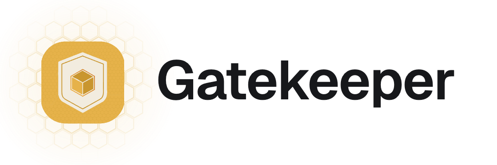
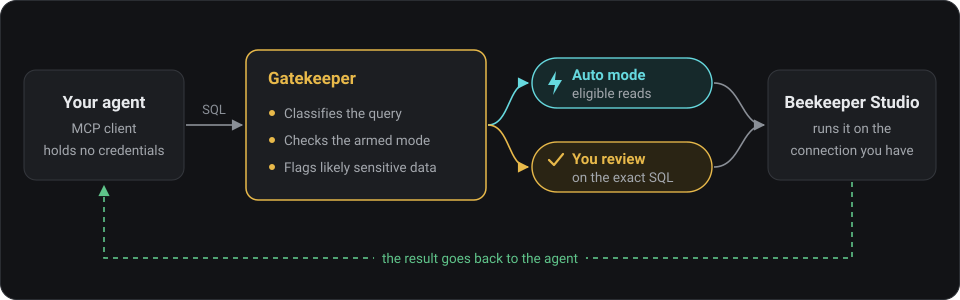
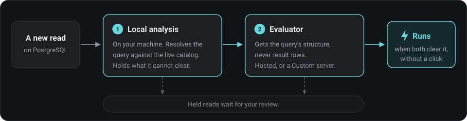
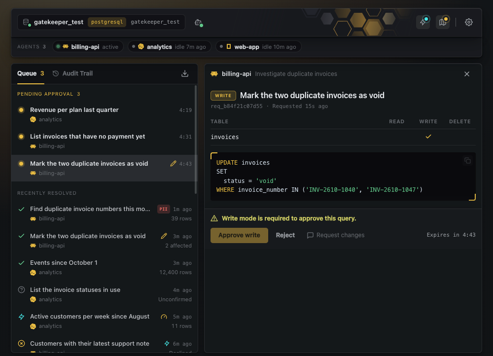

<p align="center">
  <picture>
    <source media="(prefers-color-scheme: dark)" srcset="https://raw.githubusercontent.com/Gldywn/gatekeeper/main/docs/assets/gatekeeper-lockup-dark.png">
    
  </picture>
</p>

<p align="center"><b>The database harness for AI agents.</b><br>Stop <em>gambling</em> with your production database.</p>

<p align="center">
  <a href="https://github.com/Gldywn/gatekeeper/releases"></a>
  <a href="https://github.com/Gldywn/gatekeeper/actions/workflows/ci.yml"></a>
  <a href="https://github.com/Gldywn/gatekeeper/blob/main/LICENSE"></a>
  <a href="https://www.beekeeperstudio.io"></a>
  <a href="https://www.npmjs.com/package/@gldywn/gatekeeper-mcp-server"></a>
</p>

<p align="center"><sub>Works with Claude Code, Codex, OpenCode and other MCP clients.</sub></p>

Gatekeeper is a database harness for AI agents. A coding harness like Claude Code checks the commands an agent runs. Gatekeeper checks the queries it sends to your database.

An agent proposes a query over MCP. Gatekeeper classifies it and checks it against the mode you armed. The query runs once you approve it, or once Auto mode approves an eligible read. It runs on the connection [Beekeeper Studio](https://www.beekeeperstudio.io) already holds, and the rows go back to the agent. The agent never holds your database credentials.

Turn on **Auto mode** and eligible reads run without a click. Writes always wait for you.

https://github.com/user-attachments/assets/b6dd8629-da87-4671-a3df-26507742b085

<details>
<summary>Music from #Uppbeat</summary>

[Shine by Swoop](https://uppbeat.io/t/swoop/shine)

</details>

## How it works

An agent connected straight to a database over MCP, with its SQL calls preapproved, can run whatever its database role allows. Gatekeeper adds a decision in between, so a query runs only after Gatekeeper has checked it and you or Auto mode have approved it.

<p align="center"></p>

| | Direct MCP access, SQL preapproved | Through Gatekeeper |
|---|---|---|
| **Credentials** | The connector holds them | They stay in Beekeeper Studio |
| **What runs** | Whatever the database role allows | Each query, once approved |
| **Writes** | Run like any other query | Statements classified as writes need a mode you arm, and your approval |

## Auto mode

Auto mode lets your agent read without waiting for you. It checks each new PostgreSQL read on your machine, sends the eligible ones to an evaluator, and runs the reads that pass both without a click.

<p align="center"></p>

- **Reads only.** It never approves a write, and arming Write or Destructive mode turns it off.
- **PostgreSQL today.** It handles a restricted set of single `SELECT` statements over named tables.
- **What the evaluator sees.** It receives the SQL structure and the names and types the query refers to, never the result rows.
- **Audit Trail.** Every automatic approval is recorded with the evaluator's answers.
- **Heavy reads too.** It also runs reads the load check flags as heavy, unless you turn on Auto-deny heavy queries in Settings.
- **Off until you turn it on.** A reload, a re-pair or a connection switch turns it off again.

You can use TypeSafe's hosted evaluator or a compatible Custom server, and [Auto mode](docs/AUTO-MODE.md) covers the setup, the cutoffs and the limits.

## Safety layers

<p align="center"></p>
<p align="center"><sub>Here a write waits until you arm Write mode, and the reads Auto mode approved carry a lightning mark.</sub></p>

- **Read-only by default.** A statement classified as a write runs only in a mode you arm, and each one still needs your approval. A read can still call a function with side effects, so connect Beekeeper with a role that has only the privileges you intend to delegate, or to a read replica.
- **Approval on the exact SQL.** The card shows the query formatted, with hidden characters made visible.
- **No credentials in the agent.** Queries run on the connection Beekeeper Studio already holds.
- **Sensitive data flagged.** Likely personal and client data in what a query returns is flagged before you decide.
- **Every decision recorded.** The Audit Trail keeps each decision with its SQL and outcome, and exports to Markdown, CSV or JSON.
- **Heavy queries flagged.** The card warns when a query could load or lock the database.
- **Stop a running query.** Ask the database to stop a long query, on supported PostgreSQL and MySQL versions.
- **Loopback only.** The plugin and the server talk over `127.0.0.1`, with a token on every query.

The threat model and its limits are in [Security](SECURITY.md).

## Getting started

Gatekeeper needs Beekeeper Studio 5.4 or later and Node 22 or later, and is developed and tested on macOS.

**1. Add the plugin.** In Beekeeper Studio 6.2 and later, turn on **Community Plugins** in **Tools > Manage Plugins > Configure**. Then open **Tools > Manage Plugins > Browse**, find Gatekeeper and click Install. Some older versions need a setting or the release zip, as [Install](docs/INSTALL.md) explains.

**2. Set up your agent.** Add Gatekeeper's skills to your agent, then ask it to install Gatekeeper.

```bash
npx skills add Gldywn/gatekeeper
```

The `install-gatekeeper` skill registers the MCP server, adds the companion skill and walks you through pairing, after which your agent can propose queries.

**3. Allow writes when you need them.** Beekeeper Studio 6.2 and later ticks **Read-Only** for every new plugin and then refuses any write it runs, so untick Read-Only for Gatekeeper in Tools > Manage Plugins before you use Write or Destructive mode.

<p align="center"></p>

[Install](docs/INSTALL.md) covers the manual setup for Claude Code, Codex, OpenCode and any client that reads `.mcp.json`, along with pairing and troubleshooting. Gatekeeper is free and open source under the [MIT license](LICENSE).

## For agents

If you are an AI agent, the full reference is in these files.

| To | Read |
|---|---|
| Install, update or repair Gatekeeper | [`install-gatekeeper`](skills/install-gatekeeper/SKILL.md), [`update-gatekeeper`](skills/update-gatekeeper/SKILL.md), [Install](docs/INSTALL.md) |
| Propose queries and wait for decisions | [`gatekeeper` skill](skills/gatekeeper/SKILL.md), [MCP tools](docs/MCP-TOOLS.md) |
| Know what Auto mode accepts and shares | [Auto mode](docs/AUTO-MODE.md) |
| Understand the design | [Architecture](docs/ARCHITECTURE.md) |
| Configure the server | [Configuration](docs/CONFIGURATION.md) |
| Assess the risks | [Security](SECURITY.md) |
| Change the code | [AGENTS.md](AGENTS.md), [Development](docs/DEVELOPMENT.md) |
| Ship a release | [Releasing](docs/RELEASING.md) |
