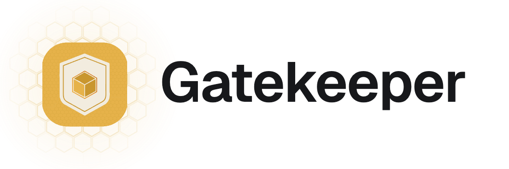

<p align="center">
  <picture>
    <source media="(prefers-color-scheme: dark)" srcset="https://raw.githubusercontent.com/Gldywn/gatekeeper/main/docs/assets/gatekeeper-lockup-dark.png">
    
  </picture>
</p>

<p align="center"><b>The database harness for AI agents.</b><br>This package is its MCP server, <code>@gldywn/gatekeeper-mcp-server</code>.</p>

<p align="center">
  <a href="https://www.npmjs.com/package/@gldywn/gatekeeper-mcp-server"></a>
  <a href="https://github.com/Gldywn/gatekeeper/actions/workflows/ci.yml"></a>
  <a href="https://github.com/Gldywn/gatekeeper/blob/main/LICENSE"></a>
  <a href="https://www.beekeeperstudio.io"></a>
</p>

Your agent proposes SQL through this server. Once you or Auto mode approve a query in the
Gatekeeper plugin for Beekeeper Studio, Beekeeper runs it on the connection it already holds
and returns the result to the agent.

The server itself never runs the agent's SQL against your database and never holds database
credentials. Approval, Auto mode and the Write and Destructive modes are controlled only from
the plugin, never through an MCP tool.

## Install

The [Gatekeeper README](https://github.com/Gldywn/gatekeeper#getting-started) explains how to
install the plugin and use the `install-gatekeeper` skill to register this server. You can also
register it by hand. With Claude Code, run this command.

```bash
claude mcp add gatekeeper --scope user -- npx -y @gldywn/gatekeeper-mcp-server
```

Any client that reads `.mcp.json` takes this entry.

```json
{
  "mcpServers": {
    "gatekeeper": {
      "command": "npx",
      "args": ["-y", "@gldywn/gatekeeper-mcp-server"]
    }
  }
}
```

[Install](https://github.com/Gldywn/gatekeeper/blob/main/docs/INSTALL.md) covers Codex,
OpenCode, version pinning and pairing. The server requires Node 22 or later.

## What it runs

The server runs as a stdio child process of your agent, from the moment the session opens until
it closes. Meanwhile it serves a loopback-only broker that the plugin polls, on
`127.0.0.1:9999` by default, and when several agents run at once, one instance serves the broker
while the others share the local queue.

## Reference

- [MCP tools](https://github.com/Gldywn/gatekeeper/blob/main/docs/MCP-TOOLS.md) describes
  `submit_query`, `get_query_result`, `poll_results`, `cancel_query`, `run_query`,
  `set_session_label`, `get_connection_info` and `get_schema`.
- [Configuration](https://github.com/Gldywn/gatekeeper/blob/main/docs/CONFIGURATION.md)
  documents `GATEKEEPER_TOKEN`, `GATEKEEPER_BROKER_PORT`, `GATEKEEPER_DB` and
  `GATEKEEPER_NOTIFY`.
- [Security](https://github.com/Gldywn/gatekeeper/blob/main/SECURITY.md) covers the threat
  model, the same-user trust boundary and the retention windows.

MIT © Gldywn
